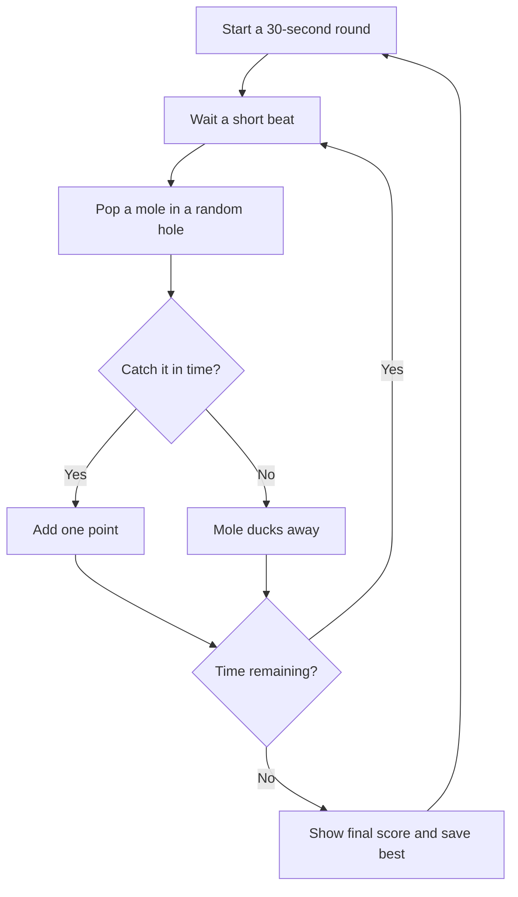

# Hole Punch

A fast little whack-a-mole game about being in exactly the right place at exactly the right time. Catch the original neon critters, chase your personal best, and try to beat the clock.

**Play:** [oscarmmi.github.io/whack-a-mole](https://oscarmmi.github.io/whack-a-mole/)

## How to play

- Start a round and catch as many moles as you can before the 30-second timer runs out.
- Click or tap a mole to score one point. Empty holes are harmless; missed moles disappear on their own.
- Use keys **1–9** to hit the matching hole, reading left to right and top to bottom.
- Press **R** any time to start a fresh round. Your personal best is saved in this browser.

## Run locally

Requires Node.js 20 or later.

```sh
npm install
npm run dev
```

Run the game-logic tests and production build with:

```sh
npm test
npm run build
```

## Game loop



## Built with

Vue 3, TypeScript, Vite, and Vitest. The game is entirely client-side; no account or backend required.
